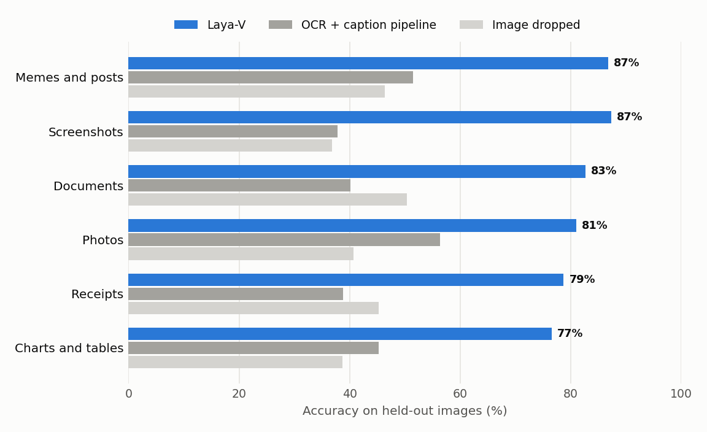
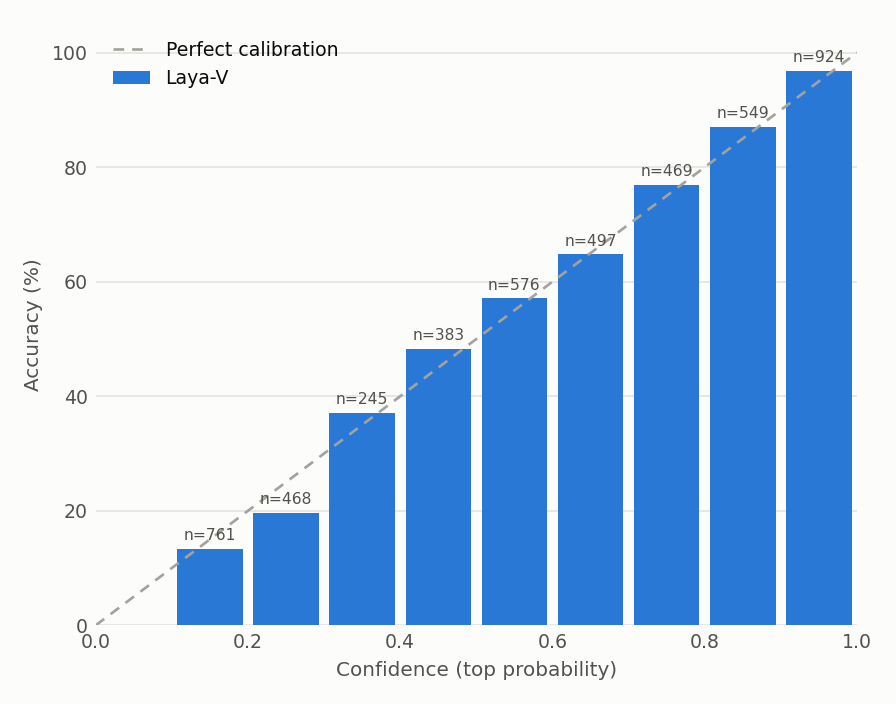
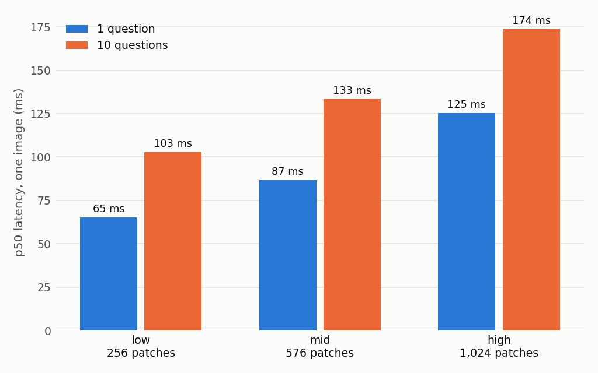

# Laya-V

**Typed decisions about images, in one forward pass, with calibrated probabilities.**

Laya-V is the vision checkpoint of [Laya](https://github.com/NandhaKishorM/laya). You give it an image
(a photo, document, receipt, chart, screenshot or meme), optional text, and a set of typed questions: yes/no
(`noul`), pick-one (`choice`) or rate-on-a-scale (`score`). It returns a probability for every option of every
question at once, without generating text.

| | |
|---|---|
| **Parameters** | 0.75B (SigLIP 2 So400m vision tower + mmBERT-base text encoder) |
| **Latency** | 87 ms p50 for 1 image + 1 question on a T4; 133 ms for 10 questions |
| **Cost** | about $0.0013 per 1,000 decisions on a $0.35/h T4 |
| **Calibration** | image ECE 0.024 out of the box |
| **Languages** | text in images and questions in any language mmBERT reads |
| **License** | Apache-2.0; public training data is Apache-2.0 / CC-BY / ODC-BY only (teacher labels disclosed below) |

## Highlights

- **It reads the image, not just the text.** 58.7% on held-out image questions, against
  36.0% for an OCR + captioning pipeline (Florence-2-large) feeding the same text model and
  32.0% with the image dropped. Laya-V beats the pipeline on 25 of 26 evaluation slices.
- **Strong on everyday image domains:** 87% on memes and posts, 87% on screenshots,
  83% on documents and 81% on photos (held-out images, questions
  labelled by the teacher).
- **94% of its teacher's accuracy** on an audited set (81.4% vs
  86.8%), at a fraction of the latency, and level with it on documents and memes.
- **Probabilities you can act on:** ECE 0.024; keeping the 80% most confident answers lifts accuracy
  from 58.7% to 69.7% (documents: 87.6%).
- **Many questions for almost the price of one:** the image is encoded once, so 10 questions take
  1.5x the time of one (133 vs 87 ms on a T4).
- **Above its weight class:** more accurate than Qwen3-VL-8B-Instruct (about 11x the parameters) on the same
  public-dataset questions, and better calibrated.

## Quickstart

```bash
pip install "laya @ git+https://github.com/HENILCHOPRA/laya@laya-v" "transformers>=5.0"
```

```python
import laya
from PIL import Image

router = laya.Router()  # text checkpoints load lazily; Laya-V loads on the first image request
result = router.predict(
    {"image": Image.open("receipt.jpg"), "note": "Reimbursement claim"},
    {
        "over_limit": {"type": "noul", "instructions": "Is the receipt total above 50?"},
        "category": {"type": "choice", "instructions": "What was bought?",
                     "criteria": {"meals": "food and drink", "travel": "transport, hotels",
                                  "other": "everything else"}},
        "legibility": {"type": "score", "instructions": "How readable is the receipt?",
                       "criteria": ["unreadable", "partly readable", "clear"]},
    },
)
answers = result["answers"]
answers["over_limit"]["noul"]            # P(yes), e.g. 0.93
answers["category"]["choice"]            # e.g. "meals"
answers["category"]["probabilities"]     # e.g. {"meals": 0.88, "travel": 0.07, "other": 0.05}
answers["legibility"]["score"]           # expected level on the 0..2 scale
answers["category"]["answer_confidence"] # calibrated confidence, use it to route or abstain
result["routing"]["model"]               # "vision"
```

```python
# many images, same questions: states share forward passes
results = router.predict_batch([{"state": {"image": p}, "questions": questions} for p in paths])

# trade detail for speed: low = 256 patches, mid = 576, high = 1,024
router.predict({"image": img, "image_detail": "low"}, questions)
```

`state["image"]` takes a PIL image, a file path, raw bytes or base64. Any other keys in the state are
read as text alongside the image (a caption, an email body, form fields).

Over HTTP, `laya-serve` (and the MCP server) also accept an image URL:

```bash
LAYA_DEVICE=cuda laya-serve
curl -s localhost:8000/predict -H 'content-type: application/json' -d '{
  "state": {"image": "https://example.com/receipt.jpg"},
  "questions": {"paid_by_card": {"type": "noul", "instructions": "Was it paid by card?"}}
}'
```

## What it is for

Laya-V is built for **closed-set decisions over images** at high volume, where you need a probability
rather than a paragraph:

- **Expense and receipt checks:** totals over a limit, payment method, tax shown, item present.
- **Document triage:** document type, which team should handle it, whether a field or signature is present.
- **Content moderation:** memes, posts and screenshots against your own policy categories.
- **Screenshot and UI triage:** what app or screen it is, whether an error is shown, what the user is doing.
- **Photo tagging:** scene, objects, attributes, quality.

Write the questions and options for your task; no fine-tuning is needed. Use `answer_confidence` to send
low-confidence cases to a person or a larger model.

**Not what it is for:** free-form answers or captions, transcribing text (OCR), and locating UI elements
on a screen (see Limitations).

## Results

All numbers are on held-out images: no training row uses an evaluation image.

### The image makes the difference



Domain rows: held-out images with teacher-labelled questions. Last row: every held-out image question, public
datasets included. The OCR + caption pipeline gives the
base `laya-multilingual` model a Florence-2-large caption and OCR text instead of the image.

| Domain | Laya-V | OCR + caption pipeline | Image dropped | n |
|---|---|---|---|---|
| Memes and posts | **86.8%** | 51.5% | 46.3% | 272 |
| Screenshots | **87.3%** | 37.8% | 36.8% | 307 |
| Documents | **82.7%** | 40.2% | 50.3% | 306 |
| Photos | **81.0%** | 56.3% | 40.7% | 300 |
| Receipts | **78.7%** | 38.8% | 45.2% | 188 |
| Charts and tables | **76.5%** | 45.3% | 38.8% | 307 |
| **All held-out image questions** | **58.7%** | 36.0% | 32.0% | 4872 |

### Close to its teacher

An audited set of 280 questions whose reference answers were checked blind by an LLM judge
(`anthropic/claude-sonnet-5`), not taken from the teacher:

| Domain | Laya-V | Teacher | n |
|---|---|---|---|
| Memes and posts | 82% | 80% | 50 |
| Screenshots | 78% | 90% | 50 |
| Documents | 86% | 86% | 50 |
| Photos | 88% | 94% | 50 |
| Receipts | 71% | 84% | 31 |
| Charts and tables | 80% | 86% | 49 |
| **All** | **81.4%** | 86.8% | 280 |

### Receipts and documents (public datasets)

| Dataset | Question | Laya-V | OCR + caption pipeline | n |
|---|---|---|---|---|
| CORD receipts | How was it paid? (4 options) | **89.3%** | 50.0% | 56 |
| CORD receipts | Is tax or a service charge shown? | **88.7%** | 62.9% | 62 |
| CORD receipts | How many line items? (4 levels) | **75.8%** | 32.3% | 62 |
| CORD receipts | Does the receipt include a given item? | 69.4% | **80.6%** | 62 |
| PixMo-Docs charts, tables, documents | Is the answer a given value? | **73.1%** | 54.5% | 156 |
| PixMo-Docs charts, tables, documents | Pick the right value (4 options) | **69.8%** | 38.0% | 242 |

### Calibrated probabilities



Temperatures are fitted on a held-out slice and ship with the checkpoint, so the probabilities are usable as
they come: when Laya-V says 80%, it is right about 80% of the time.

| Domain | ECE | Accuracy, all answers | Accuracy, 80% most confident |
|---|---|---|---|
| All held-out image questions | 0.024 | 58.7% | 69.7% |
| Memes and posts | 0.117 | 86.8% | 93.1% |
| Documents | 0.063 | 81.4% | 87.6% |
| Photos | 0.034 | 64.4% | 71.9% |
| Receipts | 0.031 | 78.3% | 83.6% |
| Charts and tables | 0.060 | 72.6% | 79.0% |

Rows cover every held-out question in the domain, public datasets included, so they differ from the
teacher-labelled accuracies above. Screenshots are left out of this table because that slice is dominated by
UI-element location (see Limitations).

### Speed and cost



End-to-end `laya.Router.predict` on a Tesla T4 (fp16), image preprocessing included, 200 real
evaluation images per setting.

| Patch budget | 1 question: p50 / p95 | 10 questions: p50 / p95 | Decisions per second |
|---|---|---|---|
| `low` (256 patches) | 65 / 99 ms | 103 / 122 ms | 97 |
| `mid` (576 patches) | 87 / 111 ms | 133 / 147 ms | 75 |
| `high` (1,024 patches) | 125 / 151 ms | 174 / 189 ms | 58 |

At $0.35 per T4-hour that is about **$0.0013 per 1,000 decisions**
(10 questions per image) or $0.0084 with one question per image.

### Above its weight class

Both models answered the same 4,873 typed questions on the same held-out images, with the same
options in the same order (Qwen3-VL-8B-Instruct through OpenRouter, asked for a probability per option).
Accuracy is the mean over the public datasets (VQAv2, A-OKVQA, PixMo-Docs, CORD, ScreenSpot).

| Model | Parameters | Accuracy, public datasets (95% CI) | Calibration error (ECE) |
|---|---|---|---|
| **Laya-V** | **0.75B** | **56.6%** (54.7%–58.4%) | **0.026** |
| Qwen3-VL-8B-Instruct | 8B | 53.5% (51.6%–55.3%) | 0.439 |

Laya-V is ahead with about a tenth of the parameters (paired McNemar test, p = 2e-06). Qwen's
answers failed to parse on 6.5% of questions and those count as wrong, so part of
the gap is formatting rather than vision.

<details>
<summary><b>Text-only behaviour</b> (text requests take the unchanged text path)</summary>

Laya-V keeps the base model's text skills close to intact: 10 of 12 suites are within 1 point or better.

| Suite | laya-multilingual | Laya-V | Δ (points) |
|---|---|---|---|
| ag_news | 93.8% | 93.2% | -0.7 |
| boolq | 78.3% | 78.3% | +0.0 |
| emotion | 51.3% | 53.5% | +2.2 |
| massive_ar | 59.0% | 55.5% | -3.5 |
| massive_de | 63.0% | 62.5% | -0.5 |
| massive_en | 70.0% | 72.5% | +2.5 |
| massive_es | 63.5% | 67.5% | +4.0 |
| massive_hi | 53.5% | 58.5% | +5.0 |
| massive_ja | 69.5% | 74.0% | +4.5 |
| prompt_injections | 57.8% | 55.2% | -2.6 |
| sst5 | 28.7% | 28.7% | +0.0 |
| typed_decisions | 35.2% | 34.5% | -0.7 |

</details>

## How it works

- **Vision tower:** SigLIP 2 So400m/16 NaFlex, which keeps each image's native aspect ratio (tall receipts
  and wide charts are not squashed). The patch budget is 256, 576 or 1,024 patches.
- **Adapter:** per-channel standardisation of the tower features, aspect-aware pooling of the patch grid
  to 128 tokens, a 2-layer MLP projector to width 768, and learned `` / `</img>` vectors.
- **One pass for all questions:** each question becomes one row
  `[CLS] <type> instructions [SEP] [MASK] option… [SEP]  128 image tokens </img> text state [SEP]`.
  The image is encoded once and its tokens are shared by every row; the mmBERT encoder and Laya's decision
  head score all options of all questions in one batched forward pass.
- Text-only requests skip the vision path entirely and behave like `laya-multilingual`.

## Training

1. **Alignment A1:** image-conditioned masked language modelling on captions (COCO, PixMo-Docs, PixMo-Cap);
   adapter only.
2. **Alignment A2:** 4-way caption matching on clusters of 4 similar images, so text alone cannot solve it;
   text encoder trainable at a low learning rate, text replay mixed in.
3. **Decisions B:** Laya's RLCD loop (GRPO-style noisy logits rewarded by strictly proper scoring rules, plus
   soft cross-entropy) on teacher-labelled image questions, public datasets converted to typed questions,
   and self-distilled text replay; a short B2 top-up with broader text replay limits text drift. The
   released weights are a WiSE-FT merge: text encoder and decision head at 0.7 x fine-tuned +
   0.3 x `laya-multilingual`.
4. **Calibration C:** temperatures fitted by LBFGS on a held-out slice, separately for text and image answers.

### Data and licenses

| Source | License | Share of training rows |
|---|---|---|
| teacher:space-bunny | teacher labels (Space Bunny Alpha, OpenRouter stealth) | 55.1% |
| public:vqav2 | CC-BY-4.0 | 12.3% |
| distill:laya-multilingual | Apache-2.0 (self-distillation of the base model) | 11.6% |
| public:pixmo-docs | ODC-BY | 7.4% |
| public:a-okvqa | Apache-2.0 | 5.3% |
| public:aria-ui | Apache-2.0 | 5.0% |
| public:cord-v2 | CC-BY-4.0 | 3.3% |

Teacher labels come from **Space Bunny Alpha**, an OpenRouter stealth model, as stated probability
distributions, with a shuffled-option consistency check on 15% of images. Every training row carries its
source, so teacher rows can be replaced if the teacher's terms require it. Dataset licenses cover the
annotations; the underlying images (COCO from Flickr, PixMo-Cap web images) carry their own terms.

## Limitations

- **Closed-set decisions only.** Laya-V scores the options you give it; it does not generate answers. It is
  not a general visual question answering model, and large generative VLMs are more accurate on
  open-domain VQA benchmarks.
- **Locating UI elements is weak.** Questions like "where on the screen is the Save button?" are answered
  only modestly above chance; use a grounding model for that.
- **Confidence does not drop on uninformative images.** On a blank grey image the mean top probability is
  58.5% (vs 58.3% on real images), so check that an image is present and readable
  before trusting a confident answer.
- **Text-only drift:** suites over the 1-point limit: prompt_injections, massive_ar. Use `laya-multilingual` for text-only
  prompt-injection filtering.
- One image per request. The fast path (`fast=True`), ONNX export and `predict_long` do not accept images yet.
- Teacher labels carry the teacher's errors and some of its overconfidence (partly corrected by calibration),
  and Laya's known quirks (negation errors, score position bias in some languages) apply here too.

## Citation

```bibtex
@misc{laya_v_2026,
  title        = {Laya-V: calibrated typed decisions over images in one forward pass},
  author       = {Chopada, Henil},
  year         = {2026},
  howpublished = {\url{https://huggingface.co/henilchopada/laya-v}}
}
```

Laya-V builds on [Laya](https://github.com/NandhaKishorM/laya) and
[`convaiinnovations/laya`](https://huggingface.co/convaiinnovations/laya), [SigLIP 2](https://huggingface.co/google/siglip2-so400m-patch16-naflex)
and [mmBERT](https://huggingface.co/jhu-clsp/mmBERT-base).
